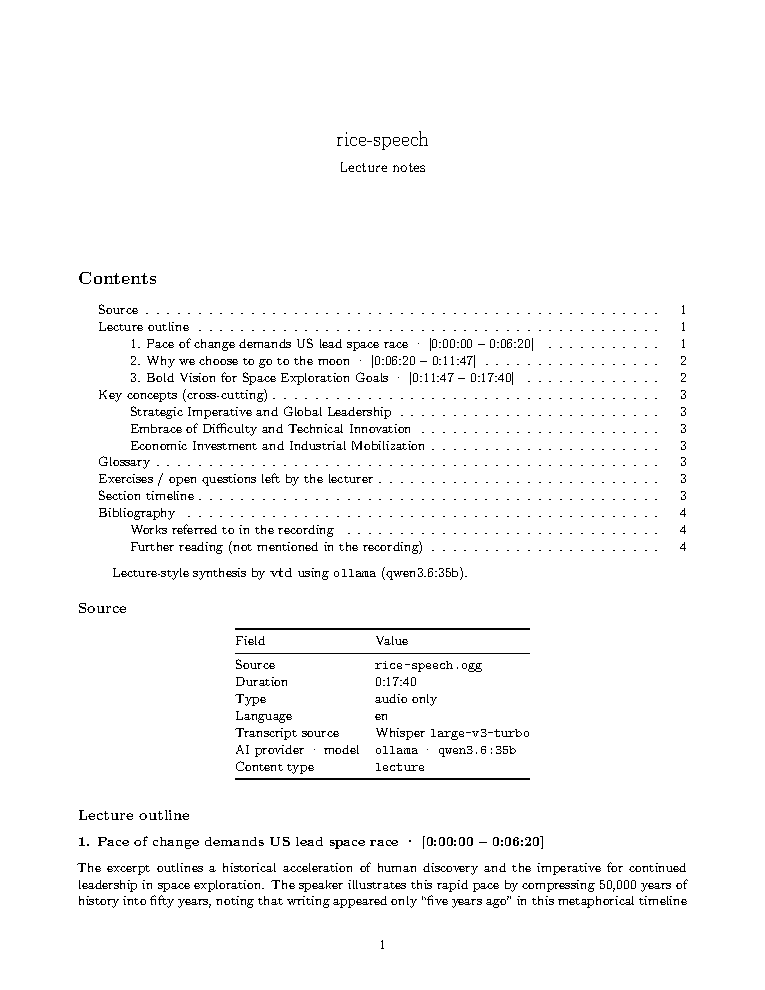

# video-to-doc (`vtd`)

`vtd` turns a recording of a class, a meeting, a seminar or a webinar into notes. Give it a video file, an audio file or a URL; it writes Markdown, and PDF too if you ask.

- **Without AI**, everything is processed on your machine: you get the transcript, a timeline of sections, the frames sampled from the video and a starter document that puts them together.
- **With `--with-ai`**, a model writes the notes: a summary of each section, with its quotations checked against the transcript, then themes, follow-ups and a glossary. The model can be Anthropic's, OpenAI's, or one running on your machine through [Ollama](https://ollama.com/).

It is a command-line tool for macOS and Linux, at version 0.1.0. See [Status](#status) for what has and has not been tried.

## Contents

- [What you get](#what-you-get)
- [Quick start](#quick-start)
- [Install](#install)
- [Usage](#usage)
- [Options](#options)
- [How it works](#how-it-works)
- [Privacy](#privacy)
- [The workspace](#the-workspace)
- [Configuration](#configuration)
- [API keys and Ollama](#api-keys-and-ollama)
- [Status](#status)
- [Help, bugs and security](#help-bugs-and-security)
- [Development](#development)

## What you get

Two documents, in a folder next to the recording, or in the current directory for a URL (the [workspace](#the-workspace)):

**`notes.starter.md`**, always. No AI is involved:

- a table about the source (file, duration, resolution, how often frames were sampled, where the transcript came from);
- the on-screen name labels that were read, if any;
- the timeline of sections, cut where the speaker pauses;
- how many frames were sampled, with the first eight listed;
- the whole transcript, with each change of speaker marked if you ran with `--speakers`.

**`notes.md`**, with `--with-ai`. Its outline depends on `--content-type`; for the default one it is:

- a table about the source (file, duration, resolution, language, AI provider and model, content type);
- the participants, when speakers were told apart with `--speakers` or name labels were read on screen;
- one numbered section per stretch of speech, each with a title, a summary and the frames it cites; with six or more sections the model is asked to group them under chapters;
- themes that recur across sections;
- open follow-ups (tasks, readings, questions left open);
- a glossary;
- the timeline;
- with `--references`, footnotes and a bibliography of the works the recording refers to.

With `--pdf` each document is also written as a PDF with an index, the cited frames shown as images, and the footnotes at the foot of the page.

### A sample

[docs/sample/notes.md](docs/sample/notes.md) is the `notes.md` vtd wrote for President Kennedy's 1962 speech at Rice University, an 18-minute audio recording in the public domain ([Wikimedia Commons](https://commons.wikimedia.org/wiki/File:Jfk_rice_university_we_choose_to_go_to_the_moon.ogg)), with a model running locally:

```bash
vtd rice-speech.ogg --language en --with-ai --provider ollama --ai-model qwen3.6:35b --content-type lecture --references --pdf
```

It is as the model wrote it; only the path of the source file was shortened. Part of it:

```markdown
# rice-speech.ogg — lecture notes

## Lecture outline

### 2. Why we choose to go to the moon  ·  [0:06:20 – 0:11:47]

The speaker argues that national preeminence in space is essential to ensure the domain
remains a "sea of peace" rather than a theater of war, emphasizing that technology itself
has no conscience and its moral value depends on human intent. […] To justify the
monumental effort required, the speaker employs rhetorical questions about climbing
mountains and crossing oceans, concluding with the famous declaration that the nation
chooses to go to the moon "not because they are easy, but because they are hard." […]

## Glossary

| Term | Definition |
|------|------------|
| **Saturn C-1** | A specific type of booster rocket tested to demonstrate increasing capability in space exploration. |
| **Mariner** | A sophisticated satellite deployed to provide safety benefits such as global navigation and storm warnings. |
```

The sample also shows what to watch for. The quotations are the speaker's words, because vtd checks them. The glossary entry for Mariner is wrong: the speech says Mariner is on its way to Venus, and credits navigation and storm warnings to other satellites. The model mixed them up, and nothing in vtd checks a definition. With `--references`, the model proposed eight works; seven were in no catalog and were left out, and the one that was found is listed as further reading, since the speech names no book.

The first page of the PDF:



## Quick start

```bash
git clone https://github.com/Mariotutal/video-to-doc.git
cd video-to-doc
./install.sh
source .venv/bin/activate
vtd path/to/recording.mp4
```

`install.sh` needs [Homebrew](https://brew.sh) on macOS and downloads a Whisper model of about 1.5 GB. On Linux you have to build `whisper-cli` yourself first; see [Install](#install).

The run prints `Workspace: <folder>` and ends with `All requested stages complete`. Open `notes.starter.md` in that folder. No API key is needed for this.

To have the notes written by a model on your machine, install [Ollama](https://ollama.com/), pull a model, and add two options:

```bash
vtd path/to/recording.mp4 --with-ai --provider ollama --ai-model qwen3.6:35b    # or another model you pulled
```

Then open `notes.md`. For Anthropic or OpenAI, see [API keys and Ollama](#api-keys-and-ollama).

## Install

Requirements:

- macOS or Linux. vtd is developed and run on macOS. Windows is not supported.
- Python 3.11 or newer.
- [`ffmpeg`](https://ffmpeg.org/), with the `ffprobe` that comes with it. Always needed.
- [`whisper.cpp`](https://github.com/ggml-org/whisper.cpp), as `whisper-cli` on the `PATH`. Needed to transcribe audio.
- [`tesseract`](https://github.com/tesseract-ocr/tesseract). Optional: reads on-screen speaker labels, and lets vtd leave frames with nothing to read out of the AI notes. Required for `--teams-captions`.
- [`yt-dlp`](https://github.com/yt-dlp/yt-dlp). Optional: only for URL inputs.
- [`sherpa-onnx`](https://github.com/k2-fsa/sherpa-onnx) and `numpy`. Optional: only for `--speakers`.
- [`pandoc`](https://pandoc.org/) and `xelatex` (from MacTeX or TeX Live). Optional: only for `--pdf`. `install.sh` does not install them.
- For `--with-ai`: an Anthropic or OpenAI API key, or Ollama running with a model pulled.

```bash
git clone https://github.com/Mariotutal/video-to-doc.git
cd video-to-doc
./install.sh
```

`install.sh` does this:

- Checks for `ffmpeg`, `whisper-cli`, `tesseract` and `yt-dlp`, and installs the missing ones: all four with Homebrew on macOS; `ffmpeg`, `tesseract` and `yt-dlp` with `apt-get` on Linux (without `apt-get` it only names the missing ones). On Linux `whisper-cli` has to be built from [whisper.cpp](https://github.com/ggml-org/whisper.cpp) and put on the `PATH` by you.
- Picks a Python that is 3.11 or newer. Set `PYTHON=/path/to/python` to choose it yourself.
- Creates `.venv/` and runs `pip install -e ".[all]"` (anthropic, openai, yt-dlp, sherpa-onnx, numpy).
- Downloads the default Whisper model (`ggml-medium.bin`, about 1.5 GB) to `~/.cache/vtd/models/`. Set `VTD_MODEL_DIR` to put it somewhere else (and `model_dir` in the config file to match), and `VTD_DEFAULT_MODEL` to download another model.

To use `vtd` without activating the virtual environment, link it:

```bash
mkdir -p ~/.local/bin && ln -sf "$PWD/.venv/bin/vtd" ~/.local/bin/vtd
```

`~/.local/bin` must be on your `PATH`.

To install by hand, with the tools above already on the `PATH`:

```bash
python3 -m venv .venv
source .venv/bin/activate
pip install -e ".[all]"
```

In place of `[all]` you can ask for `[anthropic]`, `[openai]`, `[urls]` or `[speakers]`, or for no extras. The Whisper model is then downloaded the first time a file is transcribed.

vtd is not published on PyPI; the package named `vtd` there is another project.

## Usage

### Inputs

```bash
vtd talk.mp4                      # a video: anything ffmpeg reads (.mp4, .mkv, .webm, .mov…)
vtd episode.mp3                   # audio only: the frame and OCR stages are skipped
vtd "https://example.org/talk"    # a URL: fetched with yt-dlp and kept in ~/.cache/vtd/downloads/
```

A silent Microsoft Teams recording that shows live captions can be read from the captions:

```bash
vtd meeting.mov --teams-captions
```

A frame is then sampled every 5 seconds, unless `frame_rate_seconds` is set in the config file. Use `--frame-rate 2` when the captions move fast.

### Spoken language and language of the notes

Whisper detects the spoken language. To say which it is, or to use another Whisper model:

```bash
vtd interview.mp4 --language es
vtd talk.mp4 --whisper-model large-v3-turbo
vtd talk.mp4 --whisper-model medium.en      # English only
```

The documents are written in English or Spanish, the two values `--output-language` accepts (`en`, the default, and `es`). It applies to the starter document and to the AI notes:

```bash
vtd clase.mp4 --with-ai --output-language es
```

### AI notes

```bash
export ANTHROPIC_API_KEY=sk-ant-...
vtd talk.mp4 --with-ai                                   # Anthropic, the default provider

export OPENAI_API_KEY=sk-...
vtd talk.mp4 --with-ai --provider openai

vtd talk.mp4 --with-ai --provider ollama --ai-model qwen3.6:35b   # no key; name a model you pulled
```

So far only the Ollama provider has been run on real recordings. Anthropic and OpenAI are covered by tests with stand-in clients; see [Status](#status).

`--content-type` chooses the outline of the notes and tells the model what it is reading:

| Value | For | Outline |
|---|---|---|
| `generic` (default) | anything | sections, themes, follow-ups, glossary |
| `meeting` | team meetings, workshops | participants, sections, themes, follow-ups, glossary |
| `lecture` | classes, talks | outline, key concepts, glossary, exercises and open questions |
| `podcast` | interviews, episodes | topics, notable themes, mentions and further reading, glossary |

```bash
vtd clase.mp4 --with-ai --content-type lecture
```

### Who speaks

```bash
vtd meeting.mp4 --speakers --with-ai
vtd meeting.mp4 --speakers --num-speakers 6 --with-ai
```

Each change of voice in the transcript is marked `Speaker 1`, `Speaker 2`…, and the AI notes credit what is said to those speakers. It runs on your machine with sherpa-onnx and downloads two models (47 MB) the first time. Say how many people speak when you know it; otherwise `--speaker-threshold` (default 0.7) decides how different two voices must be, and a lower value finds more speakers. With `--teams-captions` this is skipped, because the captions already name who speaks.

### PDF

```bash
vtd talk.mp4 --with-ai --pdf
```

Writes `notes.starter.pdf`, and `notes.pdf` with `--with-ai`. It needs pandoc and xelatex. The PDF font covers Latin scripts; other scripts and emoji come out blank, and vtd says so.

### References

```bash
vtd clase.mp4 --with-ai --references --pdf
```

The notes get a footnote where a work is brought up and a bibliography at the end, with further reading on the subject listed apart. Only works found in [Open Library](https://openlibrary.org/) or [Crossref](https://www.crossref.org/) are cited; see [How it works](#how-it-works). Each work the model proposes takes about a second or two to look up. To add references to notes already made, run the same command with `--resume --references`: only the AI stage runs again, and the answers it already has come from the cache.

### Running again

```bash
vtd talk.mp4 --resume                      # skip the stages already done with the same options
vtd talk.mp4 --resume --with-ai            # add AI notes to an existing workspace
vtd talk.mp4 --resume --section-gap-s 6    # change one option: only what depends on it is redone
vtd talk.mp4 --only extract-audio,transcribe
```

- Without `--resume`, every stage runs again.
- With `--resume`, a stage is redone when one of its options changed.
- `--only` takes stage names: `extract-audio`, `extract-frames`, `transcribe`, `identify-speakers`, `ocr-speakers`, `detect-sections`, `render-starter`, `synthesize`. Naming `synthesize` turns the AI stage on, and naming `identify-speakers` turns `--speakers` on. The stages built on the ones you run are marked as not done, so a later `--resume` redoes them. A stage refuses to run on inputs made with other options than the ones given: add that input's stage to `--only`, pass the original values, or use `--resume`.
- Answers from the model are kept in `ai-cache/` in the workspace, and so are the lookups of `--references`. A request identical to an earlier one is answered from there on every run, with or without `--resume`. To have the model write the notes again, delete `ai-cache/`.
- If the AI stage could not write some part (a rate limit, an answer cut off or in the wrong format), `notes.md` is still written, the run lists what is missing, and the same command with `--resume` asks only for those parts.

## Options

| Option | Default | What it does |
|---|---|---|
| `--out`, `-o` | `<source>.vtd` next to the input (in the current directory for a URL) | Workspace folder, used exactly as given |
| `--whisper-model` | `medium` | Whisper model, e.g. `small`, `medium.en`, `large-v3-turbo` |
| `--model-dir` | `~/.cache/vtd/models` | Where Whisper models are kept and downloaded to |
| `--language` | `auto` | Spoken language (`en`, `es`, `fr`…) |
| `--frame-rate` | 60, or 5 with `--teams-captions` | One frame every N seconds |
| `--ocr` / `--no-ocr` | on | Read name labels and slide text on frames |
| `--min-frame-words` | 8 | Frames with fewer readable words are left out of the AI notes; 0 keeps every frame, for recordings of diagrams or photos with little text |
| `--teams-captions` | off | Read Teams live captions on screen instead of the audio |
| `--silence-threshold-db` | -30 | Level below which audio counts as silence |
| `--silence-min-s` | 2.0 | Shortest silence that counts |
| `--section-gap-s` | 8.0 | A silence longer than this starts a new section |
| `--min-section-s` | 120 | A shorter section is joined to the next; 0 keeps them |
| `--max-section-chars` | 6000 | A section with more transcript is split at a pause; 0 never splits, otherwise at least 500 |
| `--content-type` | `generic` | `generic`, `meeting`, `lecture` or `podcast` |
| `--output-language` | `en` | `en` or `es` |
| `--speakers` | off | Tell who speaks when |
| `--num-speakers` | worked out | How many people speak |
| `--speaker-threshold` | 0.7 | How different two voices must be to be two people |
| `--pdf` | off | Also write the documents as PDF |
| `--with-ai` | off | Have a model write `notes.md` |
| `--provider` | `anthropic` | `anthropic`, `openai` or `ollama` |
| `--ai-model` | `claude-opus-4-7` (Anthropic), `gpt-5.4-mini` (OpenAI), `qwen3.6:35b` (Ollama) | Model id passed to the provider |
| `--api-key` | from the environment or the config file | Key for the provider |
| `--references` | off | With `--with-ai`: cite the works the recording refers to |
| `--resume` | off | Skip stages already done with the same options |
| `--only` | all stages | Run only the stages named |
| `--verbose`, `-v` | off | Print more |
| `--version` | | Print the version of vtd and exit |

`--ocr`, `--teams-captions`, `--speakers`, `--pdf` and `--references` each have a `--no-` form that overrides the config file for one run. `vtd --help` prints the same list.

## How it works

The stages, in order. The name in the second column is what `--only` takes.

| Stage | `--only` name | Tool | Skipped when |
|---|---|---|---|
| Fetch the source | — | `yt-dlp` | the input is a local file |
| Extract 16 kHz mono audio | `extract-audio` | `ffmpeg` | `--teams-captions` |
| Transcribe | `transcribe` | `whisper.cpp`; `tesseract` with `--teams-captions` | — |
| Sample frames, dropping near-identical ones | `extract-frames` | `ffmpeg` | there is no video |
| Tell who speaks when | `identify-speakers` | `sherpa-onnx` | without `--speakers`; with `--teams-captions` |
| Read name labels and count the words on each frame | `ocr-speakers` | `tesseract` | no video; `--no-ocr`; `--teams-captions` |
| Find the sections | `detect-sections` | `ffmpeg silencedetect`; pauses between captions with `--teams-captions` | — |
| Write the starter document | `render-starter` | Jinja2 | — |
| Write the AI notes | `synthesize` | the AI provider | without `--with-ai` |

Frames are sampled after the transcript is made. With `--teams-captions` they are sampled before it, because the captions are read from them.

What vtd does to keep the notes faithful to the recording:

- **Repeated lines.** Whisper can loop over silence or music and write one line dozens of times. From three identical lines in a row, only the first is kept. A stretch where a few phrases repeat over and over is removed. What Whisper wrote is kept in `transcript.raw.vtt` and `transcript.raw.txt`.
- **Sections.** A section starts where the speaker pauses. Very short ones are joined to the next (`--min-section-s`) and very long ones are split at a pause (`--max-section-chars`). With six or more sections, the model is asked where the subject changes, and the notes group the sections under those chapters.
- **Breaks.** A stretch with no speech is listed in the timeline but is not a numbered section. Two minutes or more with nothing in the transcript count as a break.
- **Frames.** One frame is taken every `--frame-rate` seconds and one where the picture changes (a new slide); near-identical ones are dropped. Frames with almost nothing to read (a face, an empty screen) are not sent to the model or cited. With `--no-ocr`, or without tesseract, every frame is a candidate. With `--teams-captions` every sampled frame is kept and every frame is a candidate.
- **Quotations.** Every quotation of four words or more in a section summary is checked against that section's transcript, ignoring case, accents and punctuation. One that was not said is asked for again; if it still is not word for word, its quotation marks are removed. Shorter quoted spans are taken as terms or titles and are not checked.
- **Who said what.** Whisper does not say who is speaking. Without `--speakers`, the model is told to name a person only where the transcript shows that person speaking; in practice it still credits words to the wrong person sometimes. With `--speakers`, vtd marks every change of speaker in the transcript and tells the model to follow those marks.
- **Speakers' names.** A voice is a number, not a name. The model is shown the first words of each speaker and the line said just before, and names a speaker only when they say their own name or are called by it. A name they only mention is not taken as theirs. The names are saved as `speaker_names.json` in the workspace, for example `{"1": "", "2": "Elena"}`. Correct the file by hand and run again with `--only synthesize` to use your names.
- **Small voices.** When vtd works out the number of speakers, a voice heard for less than 20 seconds in the whole recording (or less than 2% of the speech, in a short one) is not a speaker of its own. What it says between two turns of one speaker goes to that speaker; the rest is marked `Speaker ?`.
- **Tasks and readings.** Follow-ups are read from each section's transcript and then merged. They are not taken from the summaries, which tend to drop a reading mentioned in passing.
- **Length.** A summary is asked in proportion to its section: a 20-second announcement gets a sentence or two.
- **Answers.** An answer in the wrong format, or not in the language of the notes, is asked for again up to twice, with the reason. One that still cannot be used is not cached, and the run ends with `Finished with gaps` so that `--resume` asks for it again; a section's references are the exception, and are simply asked for again on the next run.

How `--references` decides what to cite:

- The model lists the books and papers each section refers to, and a few more on the subject.
- No work is cited because the model named it. Each is searched in Open Library and Crossref. It is cited only if a record has the same title, word for word apart from a spelling variant or a subtitle left out, and its first author has the surname the model gave, or one spelled nearly the same ("Vygotsky", "Vygotskiĭ"). The citation is printed as the catalog records it.
- A work is listed as referred to in the recording, with a footnote, only when that section's transcript has its author's surname, written with a capital, or its title when the title has four words or more. A shorter title, like "Deep Learning", is also what its subject is called. A real work that the speakers did not name goes under further reading.
- A work no catalog has is left out, and the run says how many were. If a catalog does not answer, the run says so and counts the references as incomplete, so the same command with `--resume` looks them up again.

Limits to know: what is checked is that the work exists, not what it says. The catalog's record may be of a reprint or a translation, with that edition's year. A work whose exact title the model does not know is not found, which happens more with small local models.

## Privacy

**What leaves your machine.** By default, nothing except three downloads: a Whisper model from huggingface.co the first time, two speaker models (47 MB, from the sherpa-onnx releases on GitHub) the first time `--speakers` is used, and the recording itself when the input is a URL. Audio extraction, transcription, OCR, speaker identification and the starter document make no other network calls.

- **`--with-ai` with Anthropic or OpenAI** sends transcript excerpts and a few sampled frames to the provider you chose. Do not use it on recordings you are not allowed to share with that provider.
- **`--with-ai --provider ollama`** sends them only to the Ollama server, which by default is the one on your machine (`http://localhost:11434`), so nothing goes to Anthropic or OpenAI. If `$OLLAMA_HOST` points to another machine, they are sent to that machine.
- **`--references`** sends the title and the first author's surname of each work the model proposes to `openlibrary.org` and `api.crossref.org`, also with a local model. These can be names and titles said in the recording (an internal report named in a meeting, for instance). The transcript itself is not sent.

**What stays on your disk.** The workspace keeps a full copy of the audio (`audio.wav`), the sampled frames, the names read from them and how many words each one shows, the transcript, the notes and, with `--with-ai`, the model's answers. A recording given as a URL is also kept whole in `~/.cache/vtd/downloads/`. vtd does not delete any of this. Treat the workspace like the recording itself: do not share or commit it by accident, and delete the folder and the download cache by hand when you are done.

**The people in the recording.** The notes can name them and quote them. Whether you may record, transcribe and share what they said is for you to settle with them.

**What the recording can do to the notes.** With `--with-ai`, the model reads what was said and what is on screen. Words in a recording can therefore steer what it writes. Read the notes before you rely on them or pass them on.

## The workspace

For `meeting.mp4`, vtd creates `meeting.mp4.vtd/` next to it (in the current directory for a URL):

```
meeting.mp4.vtd/
├── manifest.json        # state of the run, source info, stages done
├── audio.wav            # 16 kHz mono (not written with --teams-captions)
├── frames/              # frame_0001.jpg… and timestamps.json (no video: absent)
├── frame_text.json      # how many words were read on each frame (needs tesseract; not with --no-ocr, --teams-captions or no video)
├── transcript.txt
├── transcript.vtt
├── transcript.raw.*     # what Whisper wrote, only when repeated lines were removed
├── speakers.json        # names read on screen: name labels, or the caption names with --teams-captions
├── speaker_turns.json   # who speaks when (--speakers)
├── speaker_names.json   # names of the numbered speakers (--speakers and --with-ai)
├── sections.json
├── notes.starter.md     # always
├── notes.md             # --with-ai
├── notes.starter.pdf    # --pdf
├── notes.pdf            # --pdf and --with-ai
├── whisper.log          # not written with --teams-captions
└── ai-cache/            # model answers and catalog lookups, reused on every run
```

## Configuration

Optional, in `~/.config/vtd/config.toml`. Every key is shown with its default:

```toml
[defaults]
whisper_model = "medium"
# model_dir = "/Volumes/MyDisk/vtd-models"   # default: ~/.cache/vtd/models
language = "auto"
# frame_rate_seconds = 60       # unset: 60, or 5 with Teams captions. Set here, it applies to both
content_type = "generic"
output_language = "en"          # en or es
ocr_enabled = true
min_frame_words = 8
teams_captions = false
silence_threshold_db = -30
silence_min_s = 2.0
section_gap_s = 8.0
max_section_chars = 6000
min_section_s = 120
pdf = false
references = false
speakers = false
num_speakers = 0                # 0 = work it out
speaker_threshold = 0.7

[ai]
provider = "anthropic"
model = "claude-opus-4-7"
# api_key = "sk-…"              # prefer the environment variable
```

Options on the command line override the file, and the file overrides the built-in defaults. A file that cannot be read, or a value that is not valid, stops the run with a message naming the file or the option. Unknown keys under `[defaults]` and `[ai]` are reported and ignored. Anything outside those two tables, such as a key written above `[defaults]`, is ignored without a message.

## API keys and Ollama

vtd looks for the key of the provider in this order:

1. `--api-key`
2. the environment variable `ANTHROPIC_API_KEY` or `OPENAI_API_KEY`
3. `api_key` under `[ai]` in the config file

The `model` and `api_key` in the config file belong to the `provider` set there (Anthropic when none is set). They are ignored when `--provider` chooses another one, so a key is never sent to the wrong provider. Keys are never written to the workspace, the manifest or the logs.

Ollama needs no key. Start it with `ollama serve` and pull a model with `ollama pull <model>` first. Choose a model that can read images if you want the frames used; with one that cannot, vtd says so and sends only the transcript. Expect it to be much slower than a hosted model.

With a hosted provider you pay for each request at that provider's prices. vtd asks the model three things per section that has speech (its title, its summary, its follow-ups), four with `--references`, and a few more for the whole document. An answer it cannot use is asked for again, up to two more times, and each of those is another request. The default models are `claude-opus-4-7` for Anthropic, `gpt-5.4-mini` for OpenAI and `qwen3.6:35b` for Ollama; pass `--ai-model` to choose another.

## Status

vtd is at version 0.1.0, alpha, and is installed from a clone of this repository.

- **Run by hand, on macOS only:** the whole pipeline, on class recordings in Spanish of about two hours and on meeting recordings in English, including `--teams-captions`, `--speakers`, `--pdf` and `--references`.
- **AI stage:** run for real only with Ollama. It has not been run against the real Anthropic or OpenAI services; those two are covered only by tests with stand-in clients. Retries and request timeouts for them are whatever the provider's SDK does by default.
- **Automated tests:** run on Ubuntu with Python 3.11 to 3.14, with ffmpeg and tesseract installed. They do not install whisper.cpp, sherpa-onnx, pandoc or xelatex, and no test calls an AI provider or a catalog. They do not run on macOS.
- **Linux:** `install.sh` and a full run by hand are less tried than on macOS.
- **Windows:** not supported.
- **One run was timed**, the [sample](#a-sample): an 18-minute audio recording on a Mac with an Apple M4 Pro and 48 GB of memory. Without AI it took 36 seconds, with the `large-v3-turbo` Whisper model already downloaded. The AI notes took 101 seconds more, with `qwen3.6:35b` through Ollama, `--references` and `--pdf`, for three sections. The workspace takes 33 MB.
- **Not measured:** longer recordings, video, what a run costs with a hosted provider, and what hardware a local model needs.
- **The AI notes are not the same from one run to the next**, unless the answers come from the cache.

Not built yet: your own templates.

## Help, bugs and security

- **A bug or a question:** open an [issue](https://github.com/Mariotutal/video-to-doc/issues) with the command you ran, the last lines it printed, your system, your Python version and `vtd --version`. Do not attach private recordings, transcripts or keys.
- **A security problem:** do not open a public issue; see [SECURITY.md](SECURITY.md).
- **Contributing:** see [CONTRIBUTING.md](CONTRIBUTING.md), which also says how the code is organised. Changes are listed in [CHANGELOG.md](CHANGELOG.md).
- **Conduct:** see [CODE_OF_CONDUCT.md](CODE_OF_CONDUCT.md).

## Development

```bash
python3 -m venv .venv && source .venv/bin/activate
pip install -e ".[dev]"
pytest          # tests that need ffmpeg or tesseract are skipped when those are missing
ruff check .
```

The code is in `src/vtd/`: the stages in `stages/`, the AI providers in `ai/`, the documents' outlines in `templates/`, and their fixed text, in English and Spanish, in `stages/labels.py`.

## License

[MIT](LICENSE).
